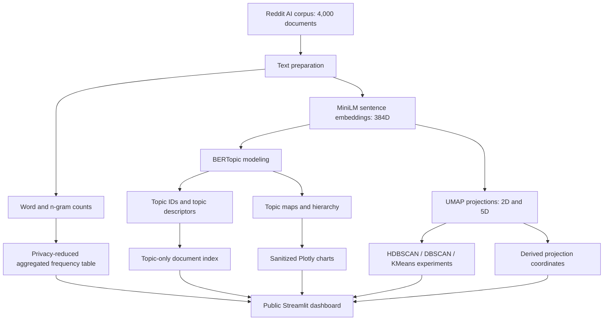

<div align="center">

# 🧠 Reddit AI Topic Explorer

### From 4,000 Reddit discussions to an interactive map of the AI conversation

**Discover emerging themes, compare AI communities, inspect topic models, and explore semantic structure through interactive NLP visualizations.**

[](https://reddit-ai-topic-explorer.streamlit.app/)
[](https://github.com/nazishatta/reddit-ai-topic-explorer)


**[🌐 Launch application](https://reddit-ai-topic-explorer.streamlit.app/)** · **[📂 Browse repository](https://github.com/nazishatta/reddit-ai-topic-explorer)** · **[🧭 Jump to exploration guide](#-suggested-exploration)**

</div>

---

## 🔎 The question behind the project

**What are people actually discussing about artificial intelligence—and how does that conversation change between communities?**

Keywords provide one view. Topic models offer another. Embedding maps expose relationships that raw counts cannot. But each visualization can also mislead if treated as objective ground truth.

**Reddit AI Topic Explorer** combines these perspectives in a four-part Streamlit dashboard built from **4,000 AI-related Reddit documents** across **four communities**: `LocalLLaMA`, `OpenAI`, `artificial`, and `singularity`.

> **Analytical principle:** Explore the same corpus through several complementary views. Compare what each representation reveals—and what it hides.

## 📊 Corpus at a glance

<div align="center">

| 📄 Documents | 🌐 Communities | 🧩 Named topics | ⚪ Unassigned |
| :---: | :---: | :---: | :---: |
| **4,000** | **4** | **15** | **1,327 (33.2%)** |

*Statistics describe the full saved corpus/model. Dashboard KPIs can change when you filter communities.*

</div>

---

## ✨ What you can explore

| Experience | Interactive controls | What it helps answer |
| :--- | :--- | :--- |
| 🔤 **01 · Honest Frequency** | Community selection, stopword toggle, n-gram length, top-term count | Which retained words and phrases occur most often? |
| 🧩 **02 · BERTopic Studio** | Topic selector and saved topic charts | Which themes did the topic model discover, and where do they appear? |
| 🧪 **03 · Clustering Lab** | HDBSCAN / KMeans / DBSCAN, algorithm-specific parameters | How do cluster assignments change when the method changes? |
| 🗺️ **04 · Embedding Atlas** | Color by community or modeled topic; include/exclude unassigned documents | How are semantic representations organized in two dimensions? |
| 🎛️ **Shared sidebar** | Select one or more Reddit communities | Which patterns persist across communities? |

> The public dashboard displays **privacy-reduced analytical artifacts**, not raw Reddit posts. The original development application includes additional full-text analysis that is not exposed by the public deployment.

## 🔤 01 · Honest Frequency

Frequent terms are a useful starting point for understanding a corpus. The dashboard shows a **ranked, horizontal bar chart** of precomputed term counts, with controls for:

- **Community:** one or several subreddits.
- **English stopwords:** include or exclude common words.
- **N-grams:** inspect unigrams, bigrams, and trigrams.
- **Top terms:** change how many terms appear in the ranking.

**Visual encoding:** bar length → number of retained term occurrences; bar label → word or phrase.

**What it reveals:** prominent vocabulary in the selected communities.

**What may mislead:** frequently repeated language is not necessarily more important, representative, or predictive. For privacy reduction, the public vocabulary includes only terms occurring **at least 10 times and in at least 10 distinct documents within a community**. Rare phrases are intentionally omitted, so the public chart is **not** a complete vocabulary inventory.

## 🧩 02 · BERTopic Studio

BERTopic combines document embeddings and clustering with topic representations, providing a thematic view beyond raw word counts.

Explore:

1. **Topic selector** — highlight a selected topic on the 2D document map.
2. **Topic keywords** — inspect model-generated descriptors.
3. **Topic-keyword chart** — compare c-TF-IDF-based topic representations.
4. **Intertopic map** — inspect relative topic-level positioning.
5. **Topic hierarchy** — inspect a hierarchical organization of modeled topics.
6. **Document map** — inspect the full-corpus visualization without original post-text hover content.

**What it reveals:** interpretable themes and candidate relationships among modeled topics.

**What may mislead:** a topic name is an automatically generated interpretation, **not** a verified label. The `-1` group represents documents the saved model did not assign to one of its named topics; it does not mean those documents are meaningless.

> **Full-corpus caveat:** the saved BERTopic JSON charts represent all 4,000 documents and do **not** respond to the subreddit filter. The selected-topic scatterplot and visible-document metric do respond to that filter.

## 🧪 03 · Clustering Lab

A topic model is not the only possible way to group semantic representations. The Clustering Lab lets you compare **three clustering algorithms** using saved **5D UMAP coordinates**:

| Algorithm | Adjustable settings | Main idea |
| :--- | :--- | :--- |
| **HDBSCAN** | Minimum cluster size, minimum samples | Find density-based groups and allow noise points |
| **DBSCAN** | Epsilon, minimum samples | Form groups based on neighborhood density |
| **KMeans** | Number of clusters | Partition observations into a specified number of groups |

The plot presents those computed labels on the saved **2D UMAP map**, alongside cluster and noise counts.

**What it reveals:** whether the apparent group structure is stable or sensitive to algorithm choices.

**What may mislead:** clusters calculated from five dimensions can look different when displayed in two. Cluster IDs are arbitrary identifiers, **not** topic IDs or quality rankings. The clustering computation uses the complete saved corpus; the community selector changes which points are displayed.

## 🗺️ 04 · Embedding Atlas

The original NLP pipeline generated **384-dimensional sentence embeddings** using **`all-MiniLM-L6-v2`** and projected them with UMAP for inspection.

In the public atlas, each point represents a document, with:

| Visual channel | Meaning |
| :--- | :--- |
| **Point** | One document-level derived observation |
| **X / Y** | Saved 2D UMAP coordinates |
| **Point color** | Selected subreddit or BERTopic label |
| **Filters** | Community selection and optional removal of unassigned documents |
| **Hover** | Synthetic document ID and community, not source post text |

**What it reveals:** local neighborhoods and the relationship between semantic position, subreddit, and modeled topic.

**What may mislead:** UMAP is a nonlinear projection. The apparent distance, area, or separation of clusters in two dimensions should not be treated as exact distance in the original embedding space.

---

## 🧠 From text to interactive analytics



**Important distinction:** the full analytical pipeline was performed during local research. The deployed dashboard loads **precomputed derived data** and runs its clustering experiments against saved 5D coordinates; it does **not** retrain BERTopic or download Reddit text on each visit.

## 🔐 Public-release design and data ethics

The live dashboard is deliberately different from the full-text research environment.

| Public deployment includes | Kept out of the public release assets |
| :--- | :--- |
| Topic labels, counts and keyword summaries | Original Reddit post text |
| Synthetic document identifiers | Original source post identifiers |
| Filtered aggregate word frequencies | Unfiltered rare-term frequency data |
| Saved UMAP coordinates | Full original document embeddings |
| Sanitized saved Plotly topic charts | Representative source documents in topic metadata |

The release builder (`build_public_release.py`) copies only an explicit set of **nine approved artifact paths** into `public_assets/` and checks basic schema, alignment, and privacy constraints.

**Limitations of these protections:** contact-pattern scans and frequency thresholds do not guarantee anonymity, prevent all contextual reidentification, or establish redistribution rights. Derived topic labels, aggregate terms, and chart metadata still warrant human review. This repository presents a privacy-reduced research demonstration, **not a certified anonymized dataset**.

### Dataset provenance

The analysis uses a sample derived from [Top Reddit Posts Daily on Hugging Face](https://huggingface.co/datasets/hblim/top_reddit_posts_daily). Consult the source dataset documentation and applicable platform/content rights before reusing or redistributing underlying Reddit material. The public application does not distribute the full-text corpus.

---

## 🛠️ Technology stack

| Layer | Tools and purpose |
| :--- | :--- |
| **App and interaction** | Python · Streamlit |
| **Data processing** | pandas · NumPy · scikit-learn |
| **Embedding generation (research pipeline)** | Sentence Transformers · `all-MiniLM-L6-v2` |
| **Topic modeling (research pipeline)** | BERTopic · HDBSCAN · c-TF-IDF |
| **Projection** | UMAP |
| **Clustering in the deployed app** | HDBSCAN · DBSCAN · KMeans |
| **Visualization** | Plotly |
| **Artifact storage** | Parquet · CSV · NumPy arrays · Plotly JSON |
| **Deployment** | GitHub · Streamlit Community Cloud |

## 📁 Repository guide

```text
reddit-ai-topic-explorer/
├── public_app.py                    # Live privacy-reduced Streamlit app
├── app.py                           # Original full-text research app (local assets required)
├── build_public_release.py         # Validate/package approved derived artifacts
├── public_assets/
│   ├── document_index.parquet
│   ├── word_frequencies_public.parquet
│   ├── topic_information_public.csv
│   ├── projections/
│   │   ├── umap_2d.npy
│   │   └── umap_5d.npy
│   └── charts/
│       ├── document_map.json
│       ├── topic_keywords.json
│       ├── topic_map.json
│       └── topic_hierarchy.json
├── requirements.txt                # Dependencies for the public app
├── requirements-training.txt       # Training/development environment
├── README_DEPLOY.md                # Public release/deployment notes
├── README.md
└── ...                              # Research and preprocessing scripts
```

> Some research scripts require raw inputs or trained model artifacts intentionally excluded from Git. A clean clone can run **`public_app.py`**, but it cannot automatically reproduce every earlier model-training stage or run the original full-text `app.py` without those private/local artifacts.

<details>
<summary><strong>💻 Run the public dashboard locally</strong></summary>

<br>

Use **Python 3.11**, the version used successfully for local testing and cloud deployment.

```bash
git clone https://github.com/nazishatta/reddit-ai-topic-explorer.git
cd reddit-ai-topic-explorer
python3.11 -m venv .venv
source .venv/bin/activate
python -m pip install -r requirements.txt
python -m streamlit run public_app.py
```

Open `http://localhost:8501`.

**Note:** `requirements.txt` is designed around Python 3.11. A Python 3.14 environment may encounter incompatible NumPy/pandas dependency constraints with the pinned versions.

</details>

<details>
<summary><strong>🧭 Suggested exploration: questions to try</strong></summary>

<br>

1. Compare the **same word-frequency settings** across `LocalLLaMA` and `OpenAI`.
2. Toggle stopword removal. Which terms disappear, and which remain prominent?
3. Increase the n-gram length. How do multiword phrases change the story?
4. In **BERTopic Studio**, select a topic and inspect its highlighted points and keyword descriptors.
5. Open the **topic hierarchy** and compare it with the intertopic map.
6. Switch **HDBSCAN → KMeans → DBSCAN** using similar views. Do the groups remain stable?
7. In **Embedding Atlas**, change the color encoding from community to modeled topic.
8. Hide unassigned documents. Does that make the plot clearer, or hide important uncertainty?

**Interpret every view with its active controls and methodological caveats.**

</details>

<details>
<summary><strong>⚠️ What the visualizations cannot establish</strong></summary>

<br>

- **Frequency ≠ significance.** Common vocabulary is not necessarily important vocabulary.
- **Topic label ≠ ground truth.** BERTopic names are interpretations of model-derived groups.
- **2D position ≠ true semantic distance.** UMAP preserves some local structure while distorting other relationships.
- **Clustering ≠ discovered natural categories.** Group assignments depend on method, parameters, and representation.
- **Subreddit comparison ≠ population comparison.** These sampled posts do not represent every Reddit user or AI discussion.
- **Public filters ≠ identical computation everywhere.** Precomputed full-corpus topic charts and full-corpus clustering do not become refitted analyses when the sidebar selection changes.
- **Privacy reduction ≠ absolute anonymity.** Derived artifacts and source rights still require careful judgment.

</details>

<details>
<summary><strong>🔬 Possible next improvements</strong></summary>

<br>

Potential future extensions (not current features):

- Quantitative topic stability and coherence evaluation.
- Topic comparison across time windows.
- Cluster agreement scores and parameter-sensitivity summaries.
- Better visual contrast and optimized reruns for CPU-intensive clustering.
- Automated deployment checks and accessibility review.
- An independently reproducible, rights-cleared training-data pipeline.

</details>

---

## 👩‍💻 Author

<div align="center">

### Nazish Atta

**M.S. Data Science · George Washington University**

Natural Language Processing · Topic Modeling · Machine Learning · Interactive Data Visualization

[](https://github.com/nazishatta)
[](https://reddit-ai-topic-explorer.streamlit.app/)

### 🧠 Explore the conversation, not just the keywords.

**Compare communities. Inspect topic hierarchies. Challenge cluster assumptions. Navigate the semantic map.**

**[🚀 Launch Reddit AI Topic Explorer →](https://reddit-ai-topic-explorer.streamlit.app/)**

</div>
